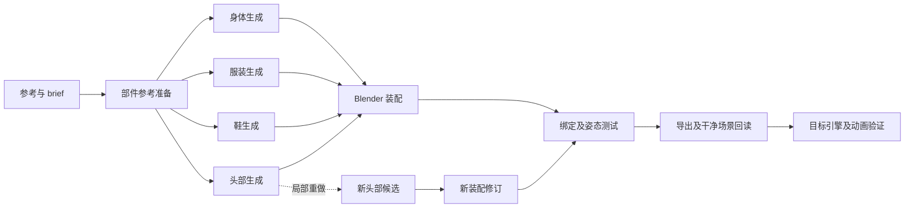

# Character pipeline

设计参考 [Tripo 的角色教程](https://www.tripo3d.ai/tutorials/agentic-canvas-game-character)：
按部件构建角色，将其装配，局部改进后再绑定与导出。下面的工具选择、哈希记录、
验收和分支机制是本库的实现，不代表 Tripo 产品内部实现。



## 当前组件

| 能力 | skill | 可选角色 |
| --- | --- | --- |
| 任务拆分、工具发现、节点记录 | character-canvas | character_planner |
| 部件定位与装配、材质和语义保留 | character-assembly | character_builder |
| 局部修改、分支、非目标部件保护 | character-local-edit | character_builder |
| 当前候选及保护属性复核 | 按上述 skill 的验收标准 | character_critic |
| 绑定、变形、导出回读、引擎验证 | character-delivery | builder + critic |

生成可接实际可用的服务、用户已有网格或本地建模工具。本库未集成 Tripo Studio
登录、API 或 Agentic Canvas UI。没有生成后端时记录 blocker；本机 Blender 可
执行装配、编辑、渲染和导出。绑定和引擎能力需要实际执行才可标记通过。

## 在新角色任务中使用

在仓库根目录执行，输入放到 `local/character-a/`：

```text
local/character-a/
├── brief.json
├── reference.png
└── parts/            # 可选：已有身体、头部、服装等资产
```

brief 可参考 `workflow/fixtures/character/brief.json`。示例的 references 为空、
三角面预算和目标引擎未指定；它可用于规划测试，不能作为完整制作需求。
真实任务按需填写参考路径、部件、预算、坐标、材质、绑定及交付要求。

```bash
python3 scripts/agents.py init runs/character-a --input local/character-a
codex -C runs/character-a
```

可粘贴 `workflow/prompts/character.md` 的内容；该 prompt 明确请求三个角色协作。
或者一次性运行：

```bash
python3 scripts/agents.py run --prompt-file workflow/prompts/character.md \
  --input local/character-a --dest runs/character-a-live --execute
```

需要逐步确认时，在 prompt 中写明 control 模式和要停下审查的节点；默认 auto
沿已授权步骤执行，只对真正需要决策的信息提问。节点验收本身可由工具完成，
不意味着每个节点都要额外请求用户确认。

批量角色复用现有 batch 启动器。清单仍然是 `id/prompt/input`，每个 input 指向
不同角色的输入目录；每项独立 workspace。不要让并行角色共同写一个 .blend。

## 节点账本

在已创建的任务 workspace 内使用以下命令：

```bash
python3 .agents/skills/character-canvas/scripts/pipeline.py init \
  inputs/brief.json artifacts/character/ledger.json

python3 .agents/skills/character-canvas/scripts/pipeline.py status \
  artifacts/character/ledger.json
```

`init` 只创建计划。agent 根据节点选择工具、实际执行，再提交产物和证据。
账本不调用生成服务，也不自动创建 3D 资产；`eligible` 只表示依赖已满足。
主 agent 串行写共享账本；worker 只返回产物与证据。账本不提供多进程写入锁。
references 路径由 agent 根据实际 brief 检查；账本不会从路径推断参考已加载。

每个节点有 `pending/blocked/produced/accepted`，验收证据或产物变化后显示
`stale`。证据检查状态严格使用 `pass/fail/unknown/not_run`。全部检查 pass 才
被记录为 accepted，且下游只能消费 accepted 的当前证据。

证据 JSON 示例（路径、哈希和日志必须来自实际执行）：

```json
{
  "scope": "当前参考文件的读取与输入完整性；未验证角色几何",
  "artifact_sha256": {"/absolute/path/to/reference-inventory.json": "actual-sha256"},
  "checks": [
    {"name": "reference_readable", "status": "pass", "evidence": ["reference-read.log"]}
  ]
}
```

`artifact_sha256` 使用产物绝对路径；checks.evidence 相对证据 JSON 所在目录解析。
记录节点：

```bash
python3 .agents/skills/character-canvas/scripts/pipeline.py record \
  artifacts/character/ledger.json reference \
  --artifact artifacts/character/reference-inventory.json \
  --evidence artifacts/character/reference-checks.json
```

账本校验文件非空、哈希绑定、证据文件存在及依赖新鲜度；这些不能证明检查
内容真实或视觉质量合格，仍需工具检查和人工/agent 审查。
默认没有自动重试。远程任务不确定时保留 job handle，例如：

```bash
python3 .agents/skills/character-canvas/scripts/pipeline.py block \
  artifacts/character/ledger.json generate/head \
  --reason 'Provider job pending; resume this handle before another submission' \
  --job-id existing-provider-task-id
```

## 只修改头部

```bash
python3 .agents/skills/character-canvas/scripts/pipeline.py fork \
  artifacts/character/ledger.json --from-node generate/head \
  --out artifacts/character/head-v2-ledger.json
```

原账本保留；新账本复用身体、衣服和鞋等未受影响的节点记录，并重置头部生成、
装配、绑定、导出及引擎验证。新产物写新目录。若改变了头部参考，从 extract/head
分支；若直接修改已装配场景，从 assemble 分支。重用同一文件并改写它会使
原账本的验收失效，因而不能在原文件上覆盖新版本。

## 已执行的验证与范围

2026-11-06 在 Blender 4.3.2 运行真实 fixture：保存四份独立部件库并装配，
另存 baseline.blend，修改 head 的局部几何并另存 candidate.blend，前后各渲染
front/side/back，导出 GLB 后在干净场景回读。

- 身体、衣服、鞋的保护签名一致，头部签名发生变化，源部件文件字节未变。
- GLB 回读后的四个网格部件名称、材质名称、尺寸通过检查。
- 保护签名覆盖 transforms、顶点、面、UV、面材质索引、材质颜色/节点类型、
  modifier 名称/类型。本测试没有 rig 或 morph，不证明这些属性的迁移。
- 这是方块人形流程测试件，不是生成角色或质量示例。参考忠实度、穿插、skin、
  动画及目标引擎全部保留 not_run。材质名称回读也不证明最终着色外观一致。
- 7 项节点账本测试覆盖依赖门槛、未知证据、哈希变化失效、局部分支和禁止覆盖。
  与原启动器测试一起共 17 项离线测试。

同日另启真实 Codex 会话 `01a1afaf-fb7b-74c2-add9-a8f6d27f217f`，初始技能目录
确实包含四个新增 skills；它读取 character-canvas 并实际调用 init/block/status，
得到 reference=blocked、其余 12 节点 pending。本次没有参考图和生成后端，
因此未继续制作角色。新增三个 character 专用角色完成 TOML/元数据检查，本次
尚未逐个实际 spawn；通用角色的真实调用验证见 live-validation.md。

复跑 fixture（输出目录必须尚不存在）：

```bash
blender --background --factory-startup \
  --python workspace/.agents/skills/character-canvas/scripts/blender_fixture.py \
  -- work/character-fixture
```

输出包含 `.blend`、`.glb`、六张图片和 `fixture-report.json`。该脚本是可选的
本地工具集成检查，GitHub CI 不依赖 Blender。
