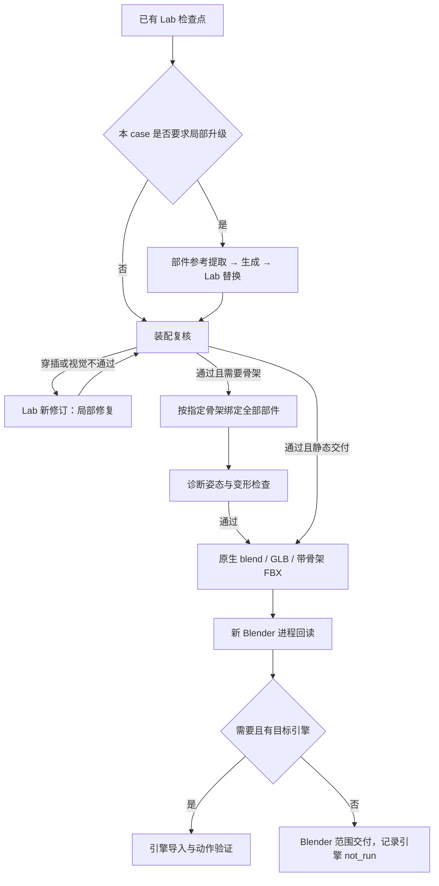

# AI 3D Lab 后续工作流

核对日期：2026-11-07。[Tripo 官方角色教程](https://www.tripo3d.ai/tutorials/agentic-canvas-game-character)
第 6 步继续用对话修正模型；第 7 步可选地提取头部参考、生成带纹理的新头并在
另一个 AI 3D Lab 中替换；第 8 步使用 Rigging 节点，导出带骨架 FBX，再进入引擎。
局部升级是可选分支，不要求每个角色重新生成头部，也没有要求加入表情控制。

本库把这些公开操作接成下列流程。验收门、姿态测试和文件哈希是我们自己的实现，
不代表 Tripo 的内部代码；没有接入未公开的 Tripo Rigging 服务。



## 从现有 case 继续

在仓库根目录准备自己的 `local/case-a/delivery.json`。可从
[brief 示例](../workflow/fixtures/post-lab/brief.json) 复制，填入真实部件名、骨架参考和
交付约束。不要复制其他角色的验收结论。然后执行：

```bash
python3 workspace/.agents/skills/character-canvas/scripts/pipeline.py from-lab \
  local/case-a/delivery.json local/case-a/delivery-ledger.json \
  --session /absolute/path/to/existing/lab
python3 workspace/.agents/skills/character-canvas/scripts/pipeline.py status \
  local/case-a/delivery-ledger.json
```

`from-lab` 校验已选修订的 receipt 和其文件哈希，固定场景、case、检查结果和相机。
它仅自动接受 `lab_checkpoint` 的文件完整性；Lab 的“检查任务完成”不会被当成
“角色无穿插”。之后选中了别的 Lab 修订也不会悄悄切换这个交付输入；新候选用
新的账本重新交接，保留旧的失败证据。不要修改旧检查点或伪造通过状态。

使用 [接续 prompt](../workflow/prompts/post-lab.md) 让 agent 执行当前可用节点。
`pipeline.py` 是带依赖和证据校验的账本，不会自己调用模型、Blender 或收费服务。
每个节点执行后用 `record --artifact ... --evidence ...` 写入当前产物的证据；
`status.eligible` 仅代表依赖已通过，不代表后端一定可用。后端缺失用
`block --reason ...` 记录。不要直接按 JSON 节点顺序跳过失败步骤。

| 节点 | 工具 / 操作 | 必须提供的检查名 |
| --- | --- | --- |
| local_upgrade，可选 | character-part-upgrade；生成时接 mesh-generation，复核接 Lab | requested_part_replaced, unaffected_parts_preserved, visual_review |
| assembly_review | three-d-ai-lab，固定四视图与接触审计 | part_inventory, protected_properties, four_view_review, intersection_review |
| rig，可选 | character-rigging，显式骨架与全部部件策略 | all_parts_bound, reference_skeleton, normalized_weights, rest_surface_preserved |
| pose_test | 诊断姿态渲染、变形和接触复核 | body_hair_deformation, clothing_shoe_deformation, posed_intersections |
| export | character-fbx-export 导出骨架 FBX；其余格式接 character-delivery | requested_formats, all_parts_exported, materials_preserved |
| roundtrip | character-fbx-export 自动新进程回读 FBX；其余格式另行回读 | parts_materials_dimensions, skeleton_weights, posed_surface_agreement |
| engine，可选 | 指定引擎真实导入与播放 | target_engine_import, target_engine_motion |

静态交付的 roundtrip 使用 `parts_materials_dimensions, static_surface_agreement`。
证据 JSON 的结构与 [角色账本](character-pipeline.md) 相同：scope、当前全部产物的
绝对路径 SHA256，以及每项 check 的 name/status/evidence 文件列表。
新增流程强制以上检查名，拒绝重复检查名。任一 fail/unknown/not_run 都不会接受
节点；`fork` 保留验收要求并使下游失效。证据格式通过不替代人的视觉判断。
`intersection_review` 必须说明检测范围、阈值、实际交叉与有意接触的判断；
三角形交叉对数不等于穿透深度或独立缺陷数。

## 历史案例与新角色的适配边界

历史案例使用身体（含头发）、衣服、左右鞋、用户指定 COM0 骨架和 Blender
验证范围。这些是该 case 的输入，不能作为新角色的默认条件。新角色先按
[新 case 工作流](new-case-workflow.md) 核对实际部件、参考骨架和姿态；不强制
低模、换头或表情系统。既要检查骨架，也要检查身体表面是否保持指定姿态。

已有 `character-delivery/scripts/rig_blender.py` 是紫发身体/服装的 case 专用策略，
目前只支持两个输入部件。新增库存预检会拒绝漏掉鞋子的配置，也会拒绝未实现的
额外部件绑定；不能以旧两部件配置导出四部件角色。新 `character-rigging/scripts/bind.py` 已支持全量部件清单、显式骨架、自动/文件权重及
刚性鞋绑定。装配通过后，选择匹配当前鞋子的绑定方式并验证变形，再接受完整角色。旧 COM0 试验的结构回读成绩不能
作为新角色姿态通过证据，尤其需要重新检查头发与躯干变形。

这轮接入的是可执行账本、技能路由、验收条件和防漏件检查。真实角色只有逐节点
执行并通过后才可称为完成绑定/交付；引擎 not_run 不会被记成通过。

## 可调用的后续技能

- [character-part-upgrade](../workspace/.agents/skills/character-part-upgrade/SKILL.md)：部件参考/生成路由、独立网格替换、非目标状态保护。融合头部先经 Lab 显式拆分。
- [character-rigging](../workspace/.agents/skills/character-rigging/SKILL.md)：完整部件清单绑定，真实参考骨架核对，自动/显式权重或刚性脚骨附件。
- [character-fbx-export](../workspace/.agents/skills/character-fbx-export/SKILL.md)：骨架 FBX 导出，新 Blender 进程验证骨架、蒙皮和诊断姿态表面。

三个脚本均要求新输出目录与输入哈希，保留旧版本。脚本产出与视觉/穿插验收分别记录。
测试资产跑通不代表任意稠密角色的热权重、颈部接缝或材质外观自动合格。
